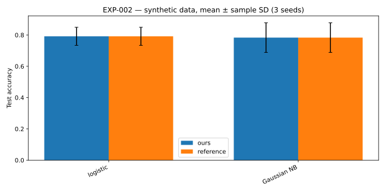

# Machine Learning From Scratch — AIR-001

**Development status: experimental implementation (unreleased).** An educational, reproducible comparison of classical machine learning algorithms implemented in NumPy. This is not a peer-reviewed publication, production library or claim of scientific novelty.

## Research question
How closely can transparent implementations reproduce the behavior of established machine learning libraries under controlled synthetic conditions?

## Algorithms
Linear regression (least squares), logistic regression (unregularized binary), K-nearest neighbors, Gaussian Naive Bayes, decision trees, random forests, K-means, principal component analysis, and least-squares gradient descent (batch, stochastic and mini-batch). NumPy provides numerical primitives; scikit-learn is used exclusively as a comparison library. Eleven metrics support regression, numeric-label accuracy, binary classification and clustering.

## Quick start
Python 3.13 was tested on Linux. From the repository root:

```sh
python -m venv .venv
# Linux: source .venv/bin/activate
# Windows PowerShell: .\.venv\Scripts\Activate.ps1
python -m pip install -e ".[research]"
python -m pytest -q
python -m ml_from_scratch.experiments
python scripts/execute_notebooks.py
```

For CPU reproducibility use one numerical-library thread (`OPENBLAS_NUM_THREADS=1`, `OMP_NUM_THREADS=1`). On PowerShell set `$env:OPENBLAS_NUM_THREADS='1'; $env:OMP_NUM_THREADS='1'`. The experiment command writes JSON and PNG/SVG figures to `results/` and `figures/` under the current directory. The notebook runner retains executed copies under `results/executed-notebooks/`.

```python
from ml_from_scratch import LinearRegression
model = LinearRegression().fit([[0], [1], [2]], [1, 3, 5])
print(model.predict([[3]]))  # [7.]
```

## Experimental evidence
Eight experiments, 78 configuration/seed records, three seeds (11, 22, 33), two matching runs at absolute tolerance 1e-10. All data are generated from deterministic synthetic distributions. See [protocol](research/protocol.md), [full results](results/benchmarks.json), [summary table](results/summary.csv) and [research report](research/report.md). The following are means over the three seeds, not confidence bounds or generalized performance claims.

| Experiment and metric | NumPy | Reference |
|---|---:|---:|
| Linear regression test MSE | 0.257542 | 0.257542 |
| Logistic regression test accuracy | 79.17% | 79.17% |
| Gaussian NB test accuracy | 78.33% | 78.33% |
| KNN k=9 Euclidean validation accuracy | 76.67% | 76.67% |
| Tree depth 3 validation accuracy | 75.00% | 75.83% |
| Forest 7 trees, 2 candidate features validation accuracy | 76.67% | 75.83% |
| PCA 2 components test reconstruction MSE | 0.331506 | 0.331506 |



## Learn and reproduce
- [Nine Jupyter notebooks](notebooks/): mathematical ideas, examples, comparisons and exercises.
- [Algorithm notes](docs/algorithm-reference.md) and [dataset provenance](datasets/README.md).
- [Notebook execution status](results/notebook-status.json) and [local tests](results/test-log.txt).
- [Reproducibility and limitations](research/limitations.md).
- [Portfolio metadata](results/portfolio-summary.json) and [RizamLearning article](docs/rizamlearning-project-article.md).

## Verification and scope
37 local tests passed; nine notebooks executed successfully (the final three were run separately after an interrupted initial notebook batch); editable package installed; eight experiments run twice. No Docker executable or Ruff was available locally. CI configuration is provided, but this local record does not certify a hosted CI run. There was no hardware runtime benchmark. Tests and findings apply only to the stated scope. See [limitations](research/limitations.md).

## Related projects and contribution
[RizamLearning](https://github.com/MarkRizam/RizamLearning) is the central learning and research portfolio. See [mathematics-for-ai](https://github.com/MarkRizam/mathematics-for-ai) and [statistics-for-ai](https://github.com/MarkRizam/statistics-for-ai). Contributions should explain assumptions, include tests and distinguish observations from proposals. See [CONTRIBUTING](CONTRIBUTING.md) and [CITATION.cff](CITATION.cff). Original software is MIT-licensed; external dependencies and references retain their own terms. No private data or third-party datasets are redistributed.
