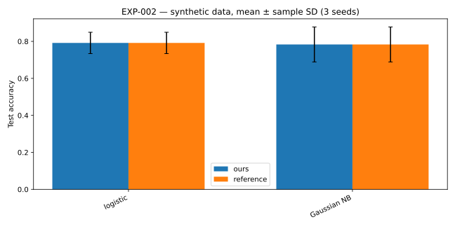
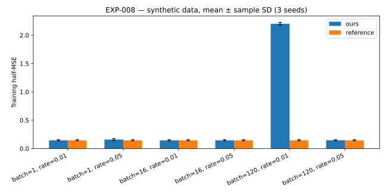

# AIR-001: Machine Learning From Scratch

**Educational research report · V1 development baseline · 24 November 2026**

## Abstract
We implemented nine classical machine learning and optimization families with NumPy and compared them with scikit-learn references under deterministic synthetic conditions. Eight experiment families produced 78 configuration/seed records across three seeds. Two executions matched at absolute tolerance 1e-10. Regression, logistic classification, KNN, Gaussian Naive Bayes and PCA showed close agreement in the evaluated settings. Tree, forest and initialization-dependent clustering behavior differed under some configurations. These results describe educational reproduction, not algorithmic novelty or real-world superiority.

## 1. Background and objectives
Transparent implementations reveal assumptions, numerical primitives and error behavior that estimator APIs may hide. Our question is how closely independent implementations reproduce reference behavior under small controlled conditions. We evaluate predictive errors, classification accuracy, probability loss, inertia, reconstruction and optimization convergence. The package uses NumPy's numerical routines but no scikit-learn estimators internally.

## 2. Methodology
The [protocol](protocol.md) was written after initial implementation and correctness tests but before benchmark execution. Synthetic supervised datasets contain 200 rows and three independent normal features per seed. Regression target: 4 + X@[1,2,-3] + Gaussian noise (standard deviation 0.5). Classification: X0 + X1 + independent standard-normal noise > 0. Splits are 120 training, 40 validation and 40 test rows. Hyperparameter sweeps use validation only; fixed regression and classification evaluations use test rows. PCA learns training-only components; clustering uses 90 generated points in three separated groups. Seeds: 11, 22, 33. Configuration and reference details are in the protocol.

## 3. Results
Means over three seeds. Full per-seed data and sample standard deviations are in [benchmarks.json](../results/benchmarks.json) and [summary.csv](../results/summary.csv).

| Metric | NumPy | Reference |
|---|---:|---:|
| OLS test MSE | 0.257542 | 0.257542 |
| Logistic test accuracy | 0.791667 | 0.791667 |
| Gaussian NB test accuracy | 0.783333 | 0.783333 |
| KNN k=9 Euclidean validation accuracy | 0.766667 | 0.766667 |
| Tree depth 3 validation accuracy | 0.750000 | 0.758333 |
| Forest 7 trees, 2 features validation accuracy | 0.766667 | 0.758333 |
| K-means++ training inertia | 6.587810 | 6.587810 |
| PCA 2 components test reconstruction MSE | 0.331506 | 0.331506 |

The random-init K-means mean inertia was 6.587810 in our implementation and 255.557134 in the reference, which had an unfavorable local minimum in at least one run. Different RNG implementations and single restarts mean this does not establish an algorithm advantage. For least-squares optimization, the mean optimum half-MSE was 0.144496. At rate 0.01 and batch size 120, 100 epochs gave 2.202856, while rate 0.05 gave 0.146773. At batch size 16 and rate 0.01, final half-MSE was 0.144568. Equal epochs are not equal update budgets.

## 4. Discussion
Agreement is expected when mathematics and configurations match; it provides a scoped correctness check. Differences in trees and forests reflect split rules, RNG and voting (our forest uses hard votes; the reference averages probabilities). The observed forest advantage in one configuration is not statistically meaningful. K-means illustrates sensitivity to initialization, and gradient descent illustrates the dependence of convergence on update frequency and learning rate. No test set was used for selecting hyperparameters. Sample standard deviations summarize the three observed runs, not confidence intervals.

## 5. Reproducibility and quality
Local Linux x86_64, Python 3.13.5, NumPy 2.3.5, SciPy 1.17.0 and scikit-learn 1.8.0. All 37 local tests passed. All nine notebooks executed in Jupyter kernels; after an interrupted batch, the last three were executed individually. Package installation and Python compilation succeeded. The experiment script repeated every run with 1e-10 absolute tolerance and zero relative tolerance. No runtime benchmarks or real datasets were evaluated. Docker and Ruff were unavailable locally; CI status is independently tracked.

## 6. Limitations and conclusion
See [limitations](limitations.md) for supported features, untested edge cases and comparisons. This project demonstrates classical machine learning foundations and reproducible experimentation. It is a starting point for further evaluation on properly licensed benchmark datasets, deeper numerical validation and controlled runtime measurement. It is not peer-reviewed research or a production replacement for established libraries.

## References
- NumPy linear algebra documentation: https://numpy.org/doc/stable/reference/routines.linalg.html
- scikit-learn user guide: https://scikit-learn.org/stable/user_guide.html
- scikit-learn evaluation guide: https://scikit-learn.org/stable/modules/model_evaluation.html

These standard documentation URLs were not independently availability-tested in the local offline environment.
